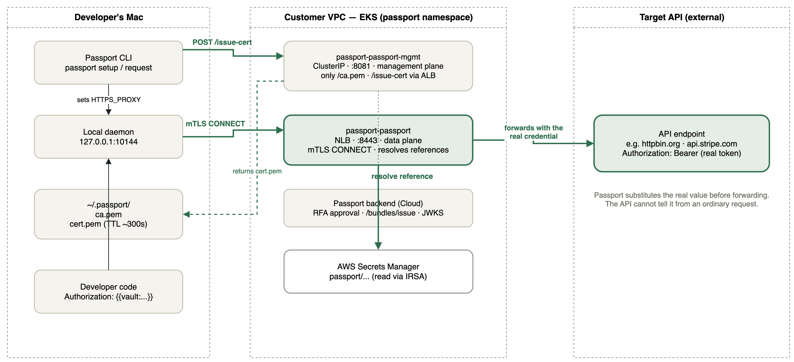

# passport-aws-sandbox

> English: [README.md](README.md) · [docs/](docs/)

[Postman Passport](https://usepassport.ai) の動作検証用 AWS サンドボックスです。Passport Proxy が実際にシークレットを解決できることを確かめるには、EKS・ALB・Secrets Manager・IAM (IRSA)・ネットワークなどひととおりの AWS 構成が必要になるため、それらを Terraform で立てられるようにしています。

Passport Proxy は private subnet の **Amazon EKS** で動かし、データプレーン (:8443) を **NLB**、管理プレーンの `/ca.pem` と `/issue-cert` を **ALB** 経由で公開します。転送先の API は `httpbin.org` のような外部 API を使うため、このリポジトリには含まれません。インフラはすべて Terraform で記述し、既存の [terraform-aws-modules](https://github.com/terraform-aws-modules) を活用しています。

> **Passport のセットアップ手順は [`docs/ja/`](docs/ja/) にまとまっています。**
> インフラ構築からアプリ利用までを4部構成の手順書にしています（[`docs/ja/README.md`](docs/ja/README.md) が目次）。
> Proxy と管理プレーンはポートフォワードではなく独自ドメインで外部公開する構成です。

## アーキテクチャ

```
                     Internet
                        │
         ┌──────────────┴──────────────┐
         │ NLB :8443        ALB :443   │  ← Service / Ingress から自動作成
         │ (データプレーン) (/ca.pem    │
         │                  /issue-cert)│
        ┌┴─────────────────────────────┴┐
        │  public subnet (AZ-a / AZ-c)  │
        │   NAT Gateway                 │
        └───────────────┬───────────────┘
                        │ target-type: ip
                        ▼
        ┌───────────────────────────────┐
        │  private subnet (AZ-a / AZ-c) │
        │   EKS Managed Node Group      │
        │     └ Pod: Passport Proxy     │
        │         :8443 / :8081         │
        └───────────────────────────────┘
```

ポイント:

- **ALB / NLB は Terraform で直接作らない。** EKS 上の AWS Load Balancer Controller が `Ingress` / `Service` を見て作成・更新します。パスやリスナーの変更が Kubernetes 側で完結し、ターゲット登録も自動化されるためです。
- VPC モジュールの `public_subnet_tags` / `private_subnet_tags` に `kubernetes.io/role/elb` と `kubernetes.io/role/internal-elb` を付与しています。**このタグが無いとコントローラが subnet を見つけられず ALB が作られません。**
- `target-type: ip` で Pod IP に直接ルーティングします（NodePort を経由しない）。
- ノードと control plane の ENI は private subnet のみ。外向き通信は NAT Gateway 経由です。
- コントローラの IAM 権限は IRSA（OIDC + ServiceAccount）で付与しています。

## アプリケーションアーキテクチャ

開発者の手元、顧客 VPC 内の Passport Proxy、転送先の Target API の3つの境界を横断して、証明書とリクエストがどう流れるかを示した構成図です。



緑の実線が Passport フローとして動作確認済みの経路です（`httpbin.org` 宛で検証）。開発者のコードには `{{vault:<UUID>}}` という参照だけを書き、Proxy が Secrets Manager で実値に解決してから転送するため、**開発者は本物の認証情報を一度も受け取りません**。詳細は [`docs/ja/`](docs/ja/) の手順書を参照してください。

### 構成要素と Passport フローのステップ対応

| コンポーネント | ステップ | 役割 |
| --- | --- | --- |
| Passport backend (Cloud) | 1〜3 | RFA 承認、`/bundles/issue`、Signed JWT Bundle の発行。リポジトリにファイルとして現れない |
| `passport-passport-mgmt`（:8081） | 4 | `POST /issue-cert` を受け、`allowedApiRefs` を含むクライアント証明書を発行 |
| ローカル daemon & `~/.passport/` | 4〜5 | 証明書を保存し、`HTTPS_PROXY` 経由でデータプレーンへの mTLS 接続を仲介 |
| `passport-passport`（:8443） | 5〜7 | mTLS 接続を受理し、参照名を Secrets Manager で解決してから Target API へ転送 |
| Target API（外部） | 7 | 転送先の API。`httpbin.org` などの外部エンドポイントを使う。リポジトリには含まれない |

## 使っている Terraform モジュール

| モジュール | バージョン | 用途 |
|---|---|---|
| `terraform-aws-modules/vpc/aws` | `~> 6.0` | VPC、public/private subnet、NAT GW、ELB 検出用タグ |
| `terraform-aws-modules/eks/aws` | `~> 21.0` | EKS クラスタ、Managed Node Group、アドオン、アクセスエントリ |
| `terraform-aws-modules/iam/aws//modules/iam-role-for-service-accounts-eks` | `~> 5.60` | ALB Controller 用の IRSA ロール（AWS 管理のポリシー相当を同梱） |
| `helm_release` (hashicorp/helm) | — | `aws-load-balancer-controller` chart のインストール |

## ディレクトリ構成

```
.
├── terraform/
│   ├── bootstrap/        # tfstate 用 S3 バケット (state はローカル)
│   ├── versions.tf       # provider / terraform のバージョン制約
│   ├── backend.tf        # S3 backend (partial configuration)
│   ├── providers.tf      # aws / helm
│   ├── variables.tf
│   ├── locals.tf         # 命名規則、AZ、subnet CIDR 計算
│   ├── vpc.tf
│   ├── eks.tf
│   ├── alb_controller.tf # IRSA + helm_release (ALB Controller)
│   ├── outputs.tf
│   └── terraform.tfvars.example
├── docs/                 # Passport セットアップ手順書 (01〜04 + トラブルシューティング)
├── assets/               # アーキテクチャ図 (drawio / png)
├── .github/workflows/    # terraform fmt / validate
└── Makefile
```

## 前提

- Terraform >= 1.5.7（S3 ネイティブロック `use_lockfile` を使うため 1.10 以上推奨）
- AWS CLI v2、kubectl、Docker、Helm（Terraform 側で使うため CLI は任意）
- 対象アカウントに VPC / EKS / IAM / ELB を作成できる権限

## セットアップ

### 1. tfstate 用 S3 バケットを作る

```bash
make bootstrap TFSTATE_BUCKET=my-tfstate-bucket-1234 REGION=ap-northeast-1
```

### 2. 変数を用意して init / apply

```bash
cp terraform/terraform.tfvars.example terraform/terraform.tfvars
# 必要に応じて編集（endpoint_public_access_cidrs は kubectl の接続元 IP に絞るのを推奨。既定は 0.0.0.0/0）

make tf-init TFSTATE_BUCKET=my-tfstate-bucket-1234
make tf-plan
make tf-apply
```

VPC・EKS・ノードグループ・ALB Controller の作成で 15〜20 分程度かかります。

### 3. kubeconfig を更新

```bash
make kubeconfig
kubectl get nodes
```

### 4. Passport Proxy をデプロイする

ここから先は Passport の設定です。手順は [`docs/ja/`](docs/ja/) にまとまっています。

| ドキュメント | 内容 |
| --- | --- |
| [`docs/ja/01-infrastructure.md`](docs/ja/01-infrastructure.md) | 上記 1〜3 の詳細 + 管理プレーン用の ACM 証明書発行 |
| [`docs/ja/02-passport-proxy.md`](docs/ja/02-passport-proxy.md) | 鍵の生成、`values.yaml` の設定、Helm でのデプロイ |
| [`docs/ja/03-dns-and-exposure.md`](docs/ja/03-dns-and-exposure.md) | Route53 のレコード作成、疎通確認、Namespaces の設定 |
| [`docs/ja/04-developer-setup.md`](docs/ja/04-developer-setup.md) | 開発者の CLI セットアップと secret reference の利用 |

転送先の API はリポジトリに含めていません。`httpbin.org` のような外部エンドポイントを
Namespace のリソースとして登録して検証します。

## 片付け

**ロードバランサーを先に消してから** `terraform destroy` を実行します。

```bash
# 1. Passport Proxy を入れている場合は Helm でアンインストール (NLB が消える)
helm uninstall passport -n passport

# 2. VPC 内に LB / SG が残っていないことを確認 (残っていたら exit 1)
make destroy-check

# 3. destroy
make tf-destroy
```

> **⚠️ ALB / NLB は Terraform の管理対象外です。**
>
> これらは AWS Load Balancer Controller が `Ingress` / `type: LoadBalancer` の Service を見て作成するため、`terraform destroy` は削除しようとしません。残したまま destroy すると、LB の ENI が private subnet を掴んだままになり、次のエラーで失敗します。
>
> ```text
> Error: deleting EC2 Subnet (subnet-xxxx): ... api error DependencyViolation:
>   The subnet 'subnet-xxxx' has dependencies and cannot be deleted.
> ```
>
> **とくに `helm uninstall passport` の消し忘れに注意してください。** Passport の NLB と ALB はどちらも Helm 管理下にあるため、残ったままだと destroy に失敗します。
>
> **LB を消しても付随するセキュリティグループ (`k8s-...`) は残ります。** その場合は次に VPC の削除が同じエラーで失敗します。`make destroy-check` は LB と SG の両方を確認します。
>
> **削除は非同期です。** `helm uninstall` の完了後、コントローラが実際に LB を消して ENI が解放されるまで **1〜3分**かかります。`make destroy-check` が「(なし)」を返すまで待ってから destroy してください。

### destroy が DependencyViolation で失敗した場合

EKS クラスタが先に消えているとコントローラも失われ、Service の削除による自動削除ができません。AWS 側から直接消します。

```bash
VPC_ID=<失敗したときの VPC ID>

# 1. 残っている LB を特定
aws elbv2 describe-load-balancers --region ap-northeast-1 \
  --query "LoadBalancers[?VpcId=='$VPC_ID'].{Name:LoadBalancerName,ARN:LoadBalancerArn}" --output table

# 2. 削除して、完全に消えるまで待つ
aws elbv2 delete-load-balancer --region ap-northeast-1 --load-balancer-arn <ARN>
aws elbv2 wait load-balancers-deleted --region ap-northeast-1 --load-balancer-arns <ARN>

# 3. ENI が解放されたことを確認 (0 になるまで待つ。削除 API 完了後も数分かかる)
aws ec2 describe-network-interfaces --region ap-northeast-1 \
  --filters Name=vpc-id,Values=$VPC_ID \
  --query 'length(NetworkInterfaces)' --output text

# 4. destroy を再実行
make tf-destroy
```

LB に付随するセキュリティグループ (`k8s-...`) も残ることがあります。destroy が今度は SG で止まった場合は、ENI 解放後に手動で削除してください。

## 本番向けに検討したいこと

- `single_nat_gateway = false` にして AZ ごとに NAT Gateway を配置（単一障害点の除去）
- `endpoint_public_access = false` + Session Manager / VPN 経由の運用
- ALB に WAF / Shield Advanced を適用
- HPA、PodDisruptionBudget、Cluster Autoscaler または Karpenter の導入
- VPC エンドポイント（S3 / CloudWatch Logs）で NAT 通信料を削減
- EKS コントロールプレーンのログ有効化とコンテナログの収集（Fluent Bit など）
- OIDC 連携した GitHub Actions からの `terraform plan` / `apply` 自動化

## ライセンス

MIT
