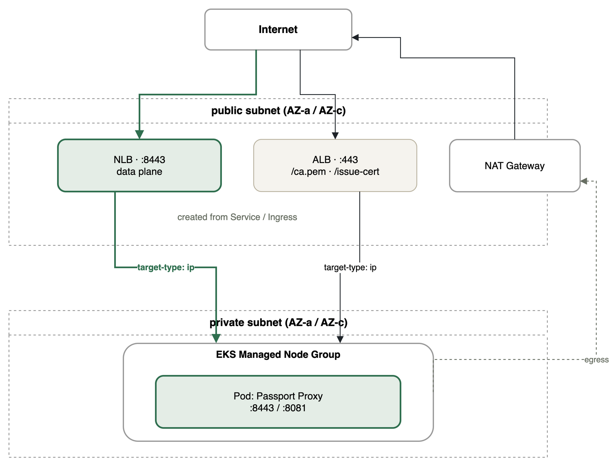

# passport-aws-sandbox

An AWS sandbox for validating [Postman Passport](https://usepassport.ai). Confirming that
the Passport Proxy can actually resolve secrets takes a full AWS setup — EKS, ALB, Secrets
Manager, IAM (IRSA), networking — so this repository stands all of it up with Terraform.

The Passport Proxy runs on **Amazon EKS** in private subnets. Its data plane (:8443) is
exposed through an **NLB**, and the management plane's `/ca.pem` and `/issue-cert` through
an **ALB**. The target API is an external one such as `httpbin.org`, so it is not part of
this repository. All infrastructure is written in Terraform, building on the existing
[terraform-aws-modules](https://github.com/terraform-aws-modules).

## Architecture



Notes:

- **Terraform does not create the ALB / NLB directly.** The AWS Load Balancer Controller
  running on EKS creates and updates them from `Ingress` / `Service` resources, which keeps
  path and listener changes on the Kubernetes side and automates target registration.
- The VPC module tags subnets with `kubernetes.io/role/elb` and
  `kubernetes.io/role/internal-elb`. **Without these tags the controller cannot find the
  subnets and no load balancer is created.**
- `target-type: ip` routes straight to pod IPs, bypassing NodePort.
- Node and control plane ENIs live only in private subnets; egress goes through the NAT
  Gateway.
- The controller's IAM permissions come from IRSA (OIDC + ServiceAccount).

## Application architecture

How certificates and requests flow across the three boundaries: the developer's machine,
the Passport Proxy inside the customer VPC, and the target API it forwards to.


The solid green line is the Passport flow verified end to end (against `httpbin.org`).
Developer code contains only a `{{vault:<UUID>}}` reference; the proxy resolves it against
Secrets Manager before forwarding, so **developers never receive the real credential**.

### Components and their step in the Passport flow

| Component | Steps | Role |
| --- | --- | --- |
| Passport backend (Cloud) | 1–3 | RFA approval, `/bundles/issue`, signing the JWT bundle. Has no file in this repository |
| `passport-passport-mgmt` (:8081) | 4 | Serves `POST /issue-cert`, issuing a client certificate carrying `allowedApiRefs` |
| Local daemon & `~/.passport/` | 4–5 | Stores the certificate and brokers the mTLS connection to the data plane via `HTTPS_PROXY` |
| `passport-passport` (:8443) | 5–7 | Accepts the mTLS connection, resolves references through Secrets Manager, forwards to the target API |
| Target API (external) | 7 | The forwarding destination — an external endpoint such as `httpbin.org`. Not part of this repository |

## Terraform modules used

| Module | Version | Purpose |
|---|---|---|
| `terraform-aws-modules/vpc/aws` | `~> 6.0` | VPC, public/private subnets, NAT GW, ELB discovery tags |
| `terraform-aws-modules/eks/aws` | `~> 21.0` | EKS cluster, managed node group, addons, access entries |
| `terraform-aws-modules/iam/aws//modules/iam-role-for-service-accounts-eks` | `~> 5.60` | IRSA role for the ALB Controller (bundles the AWS-managed policy equivalent) |
| `helm_release` (hashicorp/helm) | — | Installs the `aws-load-balancer-controller` chart |

## Repository layout

```
.
├── terraform/
│   ├── bootstrap/        # S3 bucket for tfstate (its own state stays local)
│   ├── versions.tf       # provider / terraform version constraints
│   ├── backend.tf        # S3 backend (partial configuration)
│   ├── providers.tf      # aws / helm
│   ├── variables.tf
│   ├── locals.tf         # naming, AZs, subnet CIDR math
│   ├── vpc.tf
│   ├── eks.tf
│   ├── alb_controller.tf # IRSA + helm_release (ALB Controller)
│   ├── passport.tf       # IRSA for the Passport Proxy + a demo secret
│   ├── outputs.tf
│   └── terraform.tfvars.example
├── docs/                 # Passport setup guide (01–04 + troubleshooting)
│   └── ja/               # Japanese translation
├── assets/               # architecture diagrams (drawio / png)
├── .github/workflows/    # terraform fmt / validate
└── Makefile
```

## Setup

The full procedure — infrastructure, proxy deployment, DNS, and developer setup — is in [`docs/`](docs/) (日本語版:[`docs/ja/`](docs/ja/README.md)).


## Worth considering for production

- `single_nat_gateway = false`, placing a NAT Gateway per AZ to remove the single point of failure
- `endpoint_public_access = false`, reaching the cluster through Session Manager or a VPN
- WAF / Shield Advanced in front of the ALB
- HPA, PodDisruptionBudget, and Cluster Autoscaler or Karpenter
- VPC endpoints (S3 / CloudWatch Logs) to cut NAT traffic costs
- EKS control plane logging and container log collection (Fluent Bit or similar)
- `terraform plan` / `apply` from GitHub Actions via OIDC

## License

MIT
