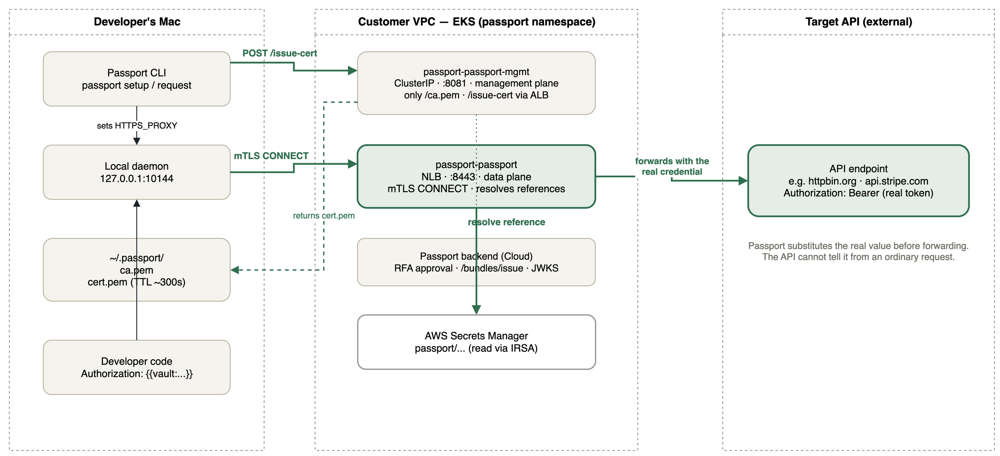

# passport-aws-sandbox

[Postman Passport](https://usepassport.ai) の動作検証用 AWS サンドボックスです。Passport Proxy が実際にシークレットを解決できることを確かめるには、EKS・ALB・Secrets Manager・IAM (IRSA)・ネットワークなどひととおりの AWS 構成が必要になるため、それらを Terraform で立てられるようにしています。

検証対象の API には、private subnet の **Amazon EKS** で動く FastAPI を public subnet の **ALB** 経由で公開する最小構成を使っています。インフラはすべて Terraform で記述し、既存の [terraform-aws-modules](https://github.com/terraform-aws-modules) を活用しています。

> **Passport のセットアップ手順は [`docs/`](docs/) にまとまっています。**
> インフラ構築からアプリ利用までを4部構成の手順書にしています（[`docs/README.md`](docs/README.md) が目次）。
> Proxy と管理プレーンはポートフォワードではなく独自ドメインで外部公開する構成です。

## アーキテクチャ

```
                     Internet
                        │
                        ▼
        ┌───────────────────────────────┐
        │  public subnet (AZ-a / AZ-c)  │
        │   ALB (internet-facing)       │  ← Ingress から自動作成
        │   NAT Gateway                 │
        └───────────────┬───────────────┘
                        │ target-type: ip
                        ▼
        ┌───────────────────────────────┐
        │  private subnet (AZ-a / AZ-c) │
        │   EKS Managed Node Group      │
        │     └ Pod: FastAPI :8000      │
        └───────────────────────────────┘
```

ポイント:

- **ALB は Terraform で直接作らない。** EKS 上の AWS Load Balancer Controller が `Ingress` リソースを見て ALB を作成・更新します。パスやリスナーの変更が Kubernetes 側で完結し、ターゲット登録も自動化されるためです。
- VPC モジュールの `public_subnet_tags` / `private_subnet_tags` に `kubernetes.io/role/elb` と `kubernetes.io/role/internal-elb` を付与しています。**このタグが無いとコントローラが subnet を見つけられず ALB が作られません。**
- ALB は `target-type: ip` で Pod IP に直接ルーティングします（NodePort を経由しない）。
- ノードと control plane の ENI は private subnet のみ。外向き通信は NAT Gateway 経由です。
- コントローラの IAM 権限は IRSA（OIDC + ServiceAccount）で付与しています。

## アプリケーションアーキテクチャ

開発者の手元、顧客 VPC 内の Passport Proxy、Target API（FastAPI on EKS）の3つの境界を横断して、証明書とリクエストがどう流れるかを示した構成図です。



緑の実線は Passport フローとして動作確認済みの経路（`httpbin.org` 宛）、赤の点線は `POST /echo` への直接アクセス（Passport 未経由）を示します。**`/echo` の `X-API-Key` 認証は、現時点では Passport の参照解決の仕組みにまだ接続されていません。** 詳細は [`docs/`](docs/) の手順書を参照してください。

### 構成要素と Passport フローのステップ対応

| コンポーネント | ステップ | 役割 |
| --- | --- | --- |
| Passport backend (Cloud) | 1〜3 | RFA 承認、`/bundles/issue`、Signed JWT Bundle の発行。リポジトリにファイルとして現れない |
| `passport-passport-mgmt`（:8081） | 4 | `POST /issue-cert` を受け、`allowedApiRefs` を含むクライアント証明書を発行 |
| ローカル daemon & `~/.passport/` | 4〜5 | 証明書を保存し、`HTTPS_PROXY` 経由でデータプレーンへの mTLS 接続を仲介 |
| `passport-passport`（:8443） | 5〜7 | mTLS 接続を受理し、参照名を Secrets Manager で解決してから Target API へ転送 |
| ALB → sample-api Pod | 7 | Target API。**`/echo` は現時点で未登録** — 図の赤い点線のみが到達する経路 |

## 使っている Terraform モジュール

| モジュール | バージョン | 用途 |
|---|---|---|
| `terraform-aws-modules/vpc/aws` | `~> 6.0` | VPC、public/private subnet、NAT GW、ELB 検出用タグ |
| `terraform-aws-modules/eks/aws` | `~> 21.0` | EKS クラスタ、Managed Node Group、アドオン、アクセスエントリ |
| `terraform-aws-modules/iam/aws//modules/iam-role-for-service-accounts-eks` | `~> 5.60` | ALB Controller 用の IRSA ロール（AWS 管理のポリシー相当を同梱） |
| `helm_release` (hashicorp/helm) | — | `aws-load-balancer-controller` chart のインストール |

ECR リポジトリのみリソースを直書きしています（モジュールを使うほどの設定量がないため）。

## ディレクトリ構成

```
.
├── terraform/
│   ├── bootstrap/        # tfstate 用 S3 バケット (state はローカル)
│   ├── versions.tf       # provider / terraform のバージョン制約
│   ├── backend.tf        # S3 backend (partial configuration)
│   ├── providers.tf      # aws / kubernetes / helm
│   ├── variables.tf
│   ├── locals.tf         # 命名規則、AZ、subnet CIDR 計算
│   ├── vpc.tf
│   ├── eks.tf
│   ├── ecr.tf
│   ├── alb_controller.tf # IRSA + helm_release + app namespace
│   ├── outputs.tf
│   └── terraform.tfvars.example
├── app/                  # FastAPI サンプル API
│   ├── main.py
│   ├── requirements.txt
│   └── Dockerfile
├── k8s/                  # Deployment / Service / Ingress
├── docs/                 # Passport セットアップ手順書 (01〜04 + トラブルシューティング)
├── .github/workflows/    # fmt / validate / docker build
└── Makefile
```

## 前提

- Terraform >= 1.5.7（S3 ネイティブロック `use_lockfile` を使うため 1.10 以上推奨）
- AWS CLI v2、kubectl、Docker、Helm（Terraform 側で使うため CLI は任意）
- 対象アカウントに VPC / EKS / IAM / ELB を作成できる権限

## セットアップ

### 1. tfstate 用 S3 バケットを作る

```bash
make bootstrap TFSTATE_BUCKET=my-tfstate-bucket-1234 REGION=ap-northeast-1
```

### 2. 変数を用意して init / apply

```bash
cp terraform/terraform.tfvars.example terraform/terraform.tfvars
# 必要に応じて編集（endpoint_public_access_cidrs は自分の IP に絞るのを推奨）

make tf-init TFSTATE_BUCKET=my-tfstate-bucket-1234
make tf-plan
make tf-apply
```

VPC・EKS・ノードグループ・ALB Controller の作成で 15〜20 分程度かかります。

### 3. kubeconfig を更新

```bash
make kubeconfig
kubectl get nodes
```

### 4. `POST /echo` 用の API キーを Secret として登録

`POST /echo` は `X-API-Key` ヘッダーによる認証が必要です。キーは git 管理せず、Kubernetes Secret として投入します（未設定の場合、`/echo` は常に 401 を返します）。

```bash
make apply-secret API_KEY=<好きな文字列>
```

`namespace` は Deployment と同じ `api`（`NAMESPACE` 変数、デフォルト `api`）に作成されます。キーをローテーションする場合も同じコマンドを再実行してください（`kubectl apply` のため既存の Secret は上書きされます）。

### 5. API をビルドして ECR に push、デプロイ

```bash
make deploy
```

`make deploy` は ECR ログイン → `docker push` → マニフェスト適用（`IMAGE_PLACEHOLDER` を ECR URL に置換）→ rollout 待ちまで行います。**事前に手順 4 で Secret を作成しておく必要があります**（先に `make deploy` すると Pod が `CreateContainerConfigError` で起動に失敗します）。

### 6. 動作確認

```bash
make url     # ALB の DNS 名
make smoke   # ALB 経由で GET /
```

ALB のプロビジョニングとヘルスチェック通過に 2〜3 分かかります。

```
GET /         -> {"message":"Hello from EKS","version":"0.1.0","hostname":"sample-api-..."}
GET /healthz  -> {"status":"ok"}
POST /echo    -> X-API-Key ヘッダーが手順 4 で設定した値と一致すればリクエストボディをそのまま返す（不一致・未指定は 401）
GET /docs     -> Swagger UI
```

```bash
# POST /echo の例
curl -X POST "http://$(make url)/echo" \
  -H "Content-Type: application/json" \
  -H "X-API-Key: <手順 4 で設定した値>" \
  -d '{"message":"hello"}'
```

## 片付け

**ロードバランサーを先に消してから** `terraform destroy` を実行します。

```bash
# 1. Passport Proxy を入れている場合は Helm でアンインストール (NLB が消える)
helm uninstall passport -n passport

# 2. sample-api の Ingress / Service を削除 (ALB が消える)
make undeploy

# 3. VPC 内に LB が残っていないことを確認 (残っていたら exit 1)
make destroy-check

# 4. destroy
make tf-destroy
```

> **⚠️ ALB / NLB は Terraform の管理対象外です。**
>
> これらは AWS Load Balancer Controller が `Ingress` / `type: LoadBalancer` の Service を見て作成するため、`terraform destroy` は削除しようとしません。残したまま destroy すると、LB の ENI が private subnet を掴んだままになり、次のエラーで失敗します。
>
> ```text
> Error: deleting EC2 Subnet (subnet-xxxx): ... api error DependencyViolation:
>   The subnet 'subnet-xxxx' has dependencies and cannot be deleted.
> ```
>
> **とくに `helm uninstall passport` の消し忘れに注意してください。** `make undeploy` は sample-api しか削除しないため、Passport Proxy の NLB が残ります。
>
> **LB を消しても付随するセキュリティグループ (`k8s-...`) は残ります。** その場合は次に VPC の削除が同じエラーで失敗します。`make destroy-check` は LB と SG の両方を確認します。
>
> **削除は非同期です。** `helm uninstall` / `make undeploy` の完了後、コントローラが実際に LB を消して ENI が解放されるまで **1〜3分**かかります。`make destroy-check` が「(なし)」を返すまで待ってから destroy してください。

### destroy が DependencyViolation で失敗した場合

EKS クラスタが先に消えているとコントローラも失われ、Service の削除による自動削除ができません。AWS 側から直接消します。

```bash
VPC_ID=<失敗したときの VPC ID>

# 1. 残っている LB を特定
aws elbv2 describe-load-balancers --region ap-northeast-1 \
  --query "LoadBalancers[?VpcId=='$VPC_ID'].{Name:LoadBalancerName,ARN:LoadBalancerArn}" --output table

# 2. 削除して、完全に消えるまで待つ
aws elbv2 delete-load-balancer --region ap-northeast-1 --load-balancer-arn <ARN>
aws elbv2 wait load-balancers-deleted --region ap-northeast-1 --load-balancer-arns <ARN>

# 3. ENI が解放されたことを確認 (0 になるまで待つ。削除 API 完了後も数分かかる)
aws ec2 describe-network-interfaces --region ap-northeast-1 \
  --filters Name=vpc-id,Values=$VPC_ID \
  --query 'length(NetworkInterfaces)' --output text

# 4. destroy を再実行
make tf-destroy
```

LB に付随するセキュリティグループ (`k8s-...`) も残ることがあります。destroy が今度は SG で止まった場合は、ENI 解放後に手動で削除してください。

## 本番向けに検討したいこと

- `single_nat_gateway = false` にして AZ ごとに NAT Gateway を配置（単一障害点の除去）
- `endpoint_public_access = false` + Session Manager / VPN 経由の運用
- ACM 証明書 + Route 53 で HTTPS 化（`k8s/ingress.yaml` のコメント部分を参照）
- ALB に WAF / Shield Advanced を適用
- HPA、PodDisruptionBudget、Cluster Autoscaler または Karpenter の導入
- VPC エンドポイント（ECR / S3 / CloudWatch Logs）で NAT 通信料を削減
- EKS コントロールプレーンのログ有効化とコンテナログの収集（Fluent Bit など）
- OIDC 連携した GitHub Actions からの `terraform plan` / `apply` 自動化

## ライセンス

MIT
